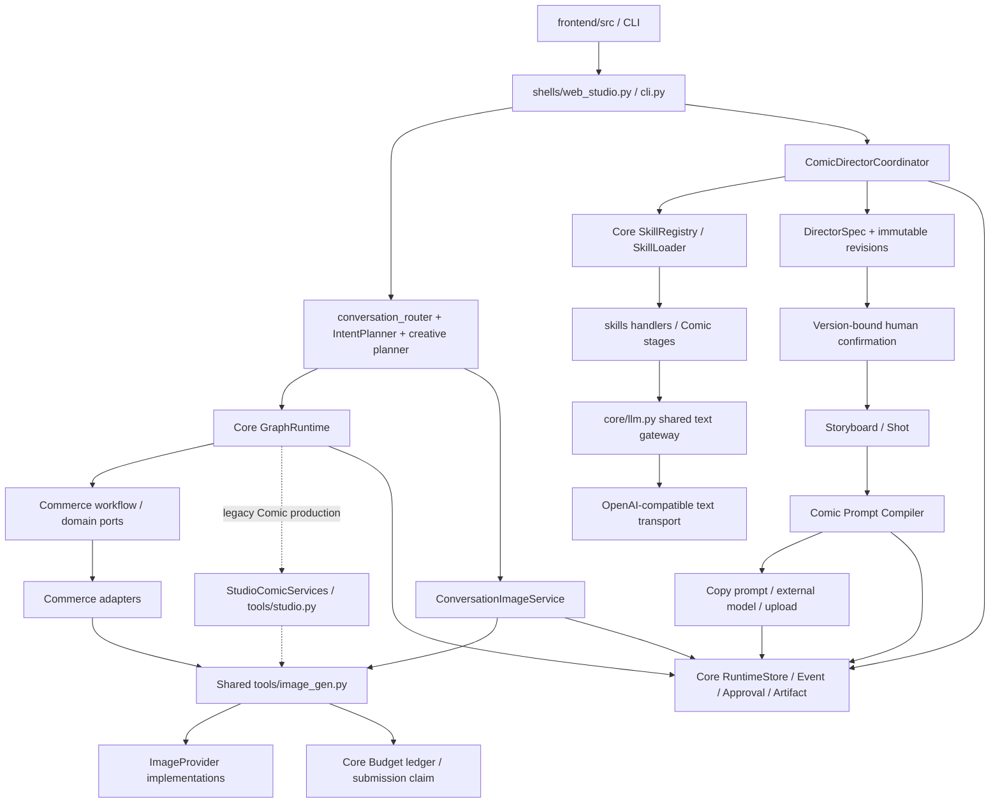

# Kantoku Architecture Health Audit

审计日期：2026-10-05。审计性质：只读工程审计及规范建立，不开发功能、不重构、不删除文件、不修改测试或数据。

后续治理状态：[Module 0](governance-module-0.md) 已完成危险脚本的引用/动态加载/启动/测试审计及原样隔离，并接入规范阅读入口、[架构例外清单](exceptions.md)。下文保留初次审计快照；F1 原文件现位于 `scripts/archive/_tail_errors.py.disabled`，没有执行账单逻辑。41 项相关回归及隔离检查通过，2026-10-06 用户已通过人工验收并授权提交 Module 0。后续顺序以例外清单末节为准：Prompt → Trace → 状态 → Core；Core 全面迁移暂停。

## 1. 审计基线与结论

基线：分支 `codex/core-v0.2-commerce-v0.1`，HEAD `c24cb81f443507bc2bde5911cd220d3935b468af`。同时检查当前工作区；已有 UI、后端入口、测试、静态 bundle 等未提交改动和已暂存的 WorkspaceShell 重命名均保留。工作区发现与已提交发现分别标注。

项目仍有共同的 Core Runtime、Artifact、Approval、SkillRegistry 和 Budget 账本。没有发现 Comic 与 Commerce 的直接 Python 导入，也没有发现第二个完整 Core Runtime。主要债务是 Core 业务语义污染、Domain 的具体供应商依赖、分散的运行编排、Prompt/历史持久化契约重叠及日志关联不完整。

优先风险是未跟踪的 `scripts/_tail_errors.py`：导入或运行就会把一批未决账单标成失败并释放。它没有核验供应商明确拒绝证据。本轮没有执行该脚本，没有证据证明它已经造成生产损失。

等级是基于静态证据的定性评价，不是性能、可用性或代码覆盖率评分：A 为边界清楚且可检查；B 为主体复用、局部债务；C 为存在跨层职责或治理缺口；D 为可直接破坏安全约束的操作风险。

| 项目 | 等级 | 依据 |
| --- | --- | --- |
| Core | C | 通用存储复用；IntentPlanner、预算身份和文本 SDK 有边界债务 |
| Domain | B- | Commerce Port 清楚；Comic 兼容图片服务和导演生命周期耦合 |
| Capability / Provider | C | 图片共享执行存在；供应商位置分散，通用文本能力边界未完整形成 |
| Frontend / Shell | C | 前端一份源码；web_studio 承担过多编排，共享呈现含 Commerce 语义 |
| 状态及持久化 | B- | Run/Node 共用枚举；跨对象投影、Artifact 状态和历史查询待治理 |
| 日志及错误 | C+ | 脱敏和上下文已有基础；持久化 Trace、CLI 边界仍无法完整关联 |
| 自动治理 | C | 结构检查通过，但不能检测本报告数项关键违规 |
| 测试工程 | B- | 领域和失败场景测试存在；夹具互相引用、源码抽取测试较脆弱，未重跑覆盖率 |
| 本地维护脚本安全 | D | 存在未跟踪的自动批量释放未知账单脚本 |
| 综合 | C | 可渐进治理；不应以大规模重写或新平行系统解决 |

## 2. 方法、覆盖及限制

先读取 AGENTS、产品原则、工程手册，再检查 Git 清单、最近提交、源码目录、导入及实际调用位置。审计范围包括 `src/kantoku/`、`skills/`、`config/` 示例、`tests/`，并延伸到前端、维护脚本和构建交付物。

- Python AST 覆盖 99 个应用文件及 6 个 Skill handler，共 105 个文件；另解析 60 个 Python 测试文件，均无语法解析错误。
- 前端枚举 59 个 TS/Vue 源码文件及 12 个 `.test.mjs` 文件，另有浏览器预览脚本；重点读取状态、API、Prompt 和共享呈现。
- 检查导入，包括解析相对 Python 导入；检查裸异常、生产测试框架依赖和函数体重复。
- 对八行及以上 Python 函数比较去位置元数据的 AST 函数体，没有发现完全相同的重复体；这不排除语义重复、TS/Vue 重复或短函数重复。
- 执行现有只读结构检查：`uv run python scripts/check_structure.py`，结果 `Structure guard: PASS`。
- 源码、Skill、测试、前端源码及 scripts 共 257 个非缓存文件建立 SHA-256 基线，用于核对本轮没有修改这些文件。

这是全目录清单和静态关系审计，加重点调用链人工阅读；不等同逐行证明全部代码正确。未运行真实模型、Provider、业务服务、维护脚本或数据库查询；未读取密钥配置或生产日志。未重跑业务回归、前端构建或启动验收，避免文档任务引入执行副作用。先前模块的测试通过记录不算本次重新验证。

Git 作者和提交信息不能证明某行由 AI 创作，故下文称“近期修改/工作区候选”，不推测作者归属。

## 3. 当前架构图与文件职责

下图同时表达现存路径和默认入口；虚线表示兼容路径及其边界债务，并非建议新建系统。

| 区域 / 文件 | 现在负责什么 | 保留或治理方向 |
| --- | --- | --- |
| `core/runtime/{models,store,graph,runner,batch}.py` | Run/Node/事件/检查点/队列/批次 | 保留唯一通用底座；生命周期调用统一复用 |
| `core/artifacts/service.py`、`core/approval/service.py` | 通用产物与审批服务 | 保留；业务确认策略仍在 Domain |
| `core/skills/{loader,registry}.py`、`skills/**/manifest.yaml` | 文件 Skill 加载、契约及执行记录 | 保留现有 Registry，禁止新建平行注册系统 |
| `domains/comic/{coordinator,director,critic,cinematography}.py` | 导演业务阶段、审核与恢复 | 保留已验收质量及人工门禁；通用运行机制待抽离复用 |
| `director_knowledge.py`、`director_provenance.py`、`skills/comic/director/knowledge/*.md` | 实际知识正文、hash 和字段来源 | 保留；方法证据与事实来源区分 |
| `domains/comic/{projects,assets,storyboards,models}.py` | 项目/资产/分镜/镜头及不可变修订 | 保留，不能清空历史来迁移 |
| `domains/comic/prompts.py` | 完整 Prompt 编译、编辑、来源、修订、外部图片登记 | 保留当前唯一 Comic 完整 Compiler；治理查询规模 |
| `domains/comic/{services,workflow,skills}.py` | 旧生产契约、业务图、旧 Prompt/归档 Skill | 兼容保留；解除具体 Provider 依赖需独立迁移 |
| `domains/commerce/workflow.py`、`ports/`、`product_image.py` | Commerce 流程、平台 Port、图片能力接口 | 正确的领域契约与依赖注入方向，保留 |
| `adapters/commerce/` | LLM/翻译/商品图及 Mock 平台适配 | 保留 Port 适配；Mock 不冒充真实平台 |
| `capabilities/{creative,image,web_search}.py` | 对话创意、图片请求、搜索 | 图片执行继续共享；业务无关能力边界待收敛 |
| `capabilities/video/{models,provider,service}.py` | 视频请求、协议、Mock 及预算产物外层 | 目前无真实 Video Provider；真实启用前验收并发与账单 |
| `tools/{image_gen,openai_image,jimeng,image_batch}.py` | 图片共享执行、具体供应商、批量包装 | 不按名称误删；位置与职责可渐进治理 |
| `tools/{prompt_factory,studio}.py`、`agent/context.py`、`memory/persona.py` | 旧 Prompt、Studio 输入及角色上下文 | 列明入口和数据迁移前保留 |
| `perception/`、`schemas/` | QC/人工复核及旧媒体契约 | 区分 QC 能力和 Comic 归档业务，不再复制另一套结果模型 |
| `shells/web_studio.py`、`conversation_router.py` | 组装、HTTP/SSE、路由及部分编排 | 保留入口；Shell 内业务编排待分阶段迁回既有领域服务 |
| `config/`、`config/settings.example.yaml` | 验证配置、统一错误及日志 | 保留；不输出密钥，未来统一错误字段 |
| `frontend/src/`、`src/kantoku/shells/web/` | 前端源码、其后端静态交付物 | 后者不是重复源码；未提交 bundle 不代表 HEAD 可复现 |

当前不存在 `src/kantoku/providers/`。具体协议分布在 tools、Commerce adapters、video provider 中；不能画一个不存在的统一 Provider 目录，也不能为对齐目录名立即复制实现。

## 4. Module A — Core 污染

| 编号 / 严重程度 | 文件及代码位置 | 问题 / 证据 | 建议 |
| --- | --- | --- | --- |
| A1 / P1 | `src/kantoku/core/conversations.py:97–195` | IntentPlanner 含 Comic/Commerce、Ozon、SKU、Listing 词表和业务澄清分支；Core 在选择业务规则 | 将领域意图规则经既有路由/领域契约注入；Core 只保留通用记录及机制 |
| A2 / P1 | `src/kantoku/core/budget.py:35–78,168–222,738–800` | 预算请求强制 `project/episode/shot_no`，并依赖图片结果/图片定价语义；Commerce 被迫填兼容镜头身份 | 在同一账本内逐步支持业务无关引用和能力计价契约，旧列/接口兼容；需要备份及迁移 |
| A3 / P1 | `src/kantoku/core/llm.py:13–39` | Core 直接持有 OpenAI SDK 和具体文本传输；共享出口正确，传输层归属不合目标边界 | 原 `chat` 接口作为兼容门面，渐进委托已有/受确认的能力和协议接口；不建第二个文本运行系统 |
| A4 / P2 | `src/kantoku/core/runtime/models.py:70` | 通用 ArtifactType 包含业务类型 LISTING | 通用类型加领域 metadata/renderer 扩展；旧 Listing 记录迁移前保留读取 |

Core 没有直接导入 Domain/Adapter/Shell 的禁用依赖；语义污染仍可存在。IMAGE/VIDEO 通用产物类型、通用预算和审核机制本身不构成污染；具体镜头身份、平台规则及供应商行为才是审计对象。

## 5. Module B — Domain 边界

| 编号 / 严重程度 | 文件及位置 | 问题 / 证据 | 建议 |
| --- | --- | --- | --- |
| B1 / P1 | `domains/comic/services.py:25–27,50–86`；`workflow.py:152–167` | Domain 导入具体 OpenAIImageProvider，`provider_for` 用配置/定价选择模型并克隆供应商；workflow 识别具体 Studio 服务及 Provider 身份 | 领域依赖 Capability 接口；模型/Provider 组装移到现有组装入口及共享能力。保留兼容且不默认启用 |
| B2 / P1 | `domains/comic/coordinator.py:280,356,631`；`core/runtime/graph.py:152,204`；`shells/web_studio.py:2677` | DirectorCoordinator、GraphRuntime、Shell tracked action 分别创建 Run、推进节点/事件及完成失败；共用 Store，但通用运行生命周期存在多处维护 | 先明确阶段业务与运行机制的责任，再复用现有 Runtime 钩子；不新建 Orchestrator |
| B3 / P1，关联 A3 | `domains/comic/critic.py:225–227`；`shells/web_studio.py` 文本阶段适配 | Domain/组装适配依赖 Core 文本出口，尚非完整 Domain→Text Capability→Provider | 随 A3 统一文本契约，不单独造 Director Agent 或 Registry |

未发现 Comic→Commerce 或 Commerce→Comic 的直接 Python 导入，包括解析后的相对导入。Domain 未直接导入模型网络 SDK；B1 是经 tools 持有具体 Provider，B3 是依赖 Core 传输出口，两者要区别描述。

Commerce `build_commerce_workflow` 使用现有 WorkflowDefinition/WorkflowNode/ConditionalEdge，并通过 SourcePort、MarketplacePort、ProductImageCapability 注入适配器；这是领域流程定义，不是第二套 Workflow 引擎。

### Comic 默认路径与兼容路径

当前默认：确认 Director → Storyboard/Shot → 完整 Image Prompt → 编辑/确认/复制 → 等待外部图片 → 上传并登记现有 IMAGE Artifact。`prompts.py:364` 的导入明确不经过 Provider/预算/图片工作流。

旧 Studio/CLI、`comic.production.v1`、首页、Commerce 内部图片路径仍存在。`quick_creation.future_image_model_selection` 是显式未来能力开关；当前没有接入新 Comic 默认图片生成 API。保留内部兼容代码不能解读为允许把它重新设为默认流程。

## 6. Module C — 重复实现与职责重叠

### Agent、Coordinator、Orchestrator、Runner

| 实现 | 职责 | 判断 |
| --- | --- | --- |
| `agent/loop.py:125 run` | CLI LLM 工具调用循环 | 与持久化图运行不是同一契约，不直接判为重复 Agent |
| `core/runtime/graph.py GraphRuntime` | 通用图执行/恢复/检查点 | 唯一既有图底座，应复用 |
| `core/runtime/runner.py:83 TaskRunner` | 有界后台线程与日志上下文传播 | 调度设施，不是业务 Orchestrator |
| 同文件 InMemoryTaskQueue / Worker | 轻量队列及 Worker 抽象 | 需核对实际入口才能决定收敛，未证明可删除 |
| ComicDirectorCoordinator | 导演阶段、知识、审核、修订 | 业务角色合理；通用生命周期与 Graph 重叠，见 B2 |
| IntentPlanner / plan_creative_turn / conversation_router / stream_conversation | 意图、创意、入口选择、对话执行 | 路由决策跨多处，修改一处可能被另一处覆盖，P1 编排债务 |
| SkillRegistry / agent tools_registry | 文件 Skill 契约 / LLM 函数工具契约 | 不同责任，不应按 Registry 名称合并 |

没有发现完整第二套 RuntimeStore/Artifact/Budget。One Orchestrator 目标尚未完全落实到“只有一处维护通用运行生命周期”，不能因此把现有多个角色全部删除。

P2：`domains/comic/skills.py:25 comic_skills()` 与 `skills/comic/{compose_prompt,archive_image}/manifest.yaml` 重复声明相同 Skill ID 及契约。当前 Web 组装仅使用 SkillLoader；在源码、Skill、测试中未找到 comic_skills 的直接调用。它是并行定义/兼容候选，不是第二个 Registry；仍需排查外部及动态调用后才能决定是否收敛，本轮不删除。

### Prompt 和 Context 入口

| 文件 / 入口 | 输入与产物 | 问题 |
| --- | --- | --- |
| `tools/prompt_factory.py:86 build_prompt` | 旧 Shot/Persona/history → PromptRecipe | 旧生产与独立 Recipe 持久化 |
| `tools/studio.py:39 compose_prompt`、`:55 refine_prompt` | Studio 四项需求或文本改写 | 简易 Prompt 与 LLM 改写契约 |
| `shells/web_studio.py:286 _enhance_prompt` | 需求 → 技术化 Prompt | 能力逻辑留在 Shell |
| `capabilities/creative.py:92,230` | 对话决策/创意上下文 → 图片 Prompt | 另一种输入契约，不等同镜头 Compiler |
| `domains/comic/prompts.py:108 StructuredImagePromptCompiler` | 固定 Director/Shot/资产 → 五段完整 Prompt + Core Artifact | 新 Comic 的完整 Prompt 正确出口 |
| `agent/context.py`、`ComicContextBuilder`、CreativeContext | 旧角色窗口 / 作品不可变快照 / 对话创意 | 三类上下文有合理差异，但事实来源与约束抽取重叠 |

P1：入口与事实存储分散。Legacy Persona/PromptRecipe 与 ProjectAsset/Prompt Artifact 不是同一真相源，也没有统一迁移协议。先建立输入/约束/输出/版本的契约矩阵，再复用共同约束及能力；不能把五个函数机械合成一个巨函数或再增加 PromptManager。

P1：`domains/comic/prompts.py:338–363` 每个 Prompt payload 检索最多 100000 个 Comic Run 判断确认，并检索全库 IMAGE Artifact 匹配上传；`core/runtime/store.py:1054` 的 Artifact 列表没有分页参数。项目 Prompt 数量与历史 Run/图片量共同放大查询和反序列化。另有版本历史查找与 Bible 复用遍历。静态证据说明扩展风险，本轮没有性能压测，不能断言当前已超时。建议在现有 Store 内增加受约束查询/索引，保持版本确认与上传关联不变。

### 图片入口职责

| 名称 / 文件 | 实际责任 |
| --- | --- |
| ConversationImageService / `capabilities/image.py` | 对话媒体任务、Artifact 和任务投影；共享生图执行的调用方 |
| gen_image / reconcile_image / `tools/image_gen.py` | 共享预占、提交认领、供应商调用与对账 |
| ImageProvider protocol / 同文件 | 协议契约 |
| OpenAIImageProvider、AlibabaQwenImageProvider / `tools/openai_image.py` | 具体模型平台协议及响应处理 |
| VolcengineJimengProvider / `tools/jimeng.py` | 即梦协议 |
| StudioComicServices / `domains/comic/services.py` | 旧 Comic 业务适配，最终仍用共享 gen_image |
| CoreProductImageCapability / `adapters/commerce/product_image.py` | Commerce 请求适配，同样复用 gen_image |
| Comic 外部图片导入 / `domains/comic/prompts.py` | 用户文件登记、固定版本及 Core Artifact；不调用生图 |

这些名字不是四套独立生图引擎。P1 是共享执行在 tools、具体供应商渗透 Domain、ConversationImageService 绑定对话上下文的边界问题；治理不得复制新的 ImageService 或重写 Qwen 架构。

## 7. Module D — 状态管理

| 对象 | 当前状态定义 | 责任与判断 |
| --- | --- | --- |
| Run / Node | `core/runtime/models.py:17`：pending/running/waiting/completed/failed/cancelled | 已共用 ExecutionStatus，保留唯一权威定义 |
| Batch | 同文件 :28：含 partial_failed | 汇总状态，不等于单个 Run |
| Approval | 同文件 :53：pending/approve/reject/request_revision | 人工决策；前端 approved 是结果投影，不宜直接当 Run 状态 |
| Core Artifact | 同文件 :108：status 为自由字符串 | 缺少统一合法状态及迁移约束，P2 |
| Conversation MediaJob | `core/conversations.py:66`：pending/generating/completed/failed | 媒体展示状态，与 Run 需显式映射 |
| Provider 图片结果 | `schemas/media.py:11`：succeeded/failed/unknown | 供应商结果；unknown 不能视为 failed |
| 视频结果 | `capabilities/video/models.py`：另含 rejected/blocked | 能力拒绝语义及 Mock 标记需保留 |
| Budget Ledger | `core/budget.py`：reserved/submitted/succeeded/failed/unknown/settled/released | 账单状态，不应与执行状态合成一个枚举 |
| Legacy Studio Task | `tools/studio.py StudioTask` + 前端 TaskStatus | 输入 DTO 无持久化 status，页面依据结果/账本投影 draft/succeeded/failed/unknown |
| Comic Project / Storyboard | `domains/comic/models.py`：项目 draft/planning/production/completed/archived；分镜 draft/planning/approved/archived | 业务生命周期，不是 Runtime 状态 |
| Comic Shot | 同文件 :556：draft/planned/generating/checking/approved/failed/repairing/deleted | 创作/审核实体状态；部分值为兼容或预留，不能视为都被默认路径执行 |
| Comic 外部媒体 | Prompt 与 Artifact 派生 prompt_pending/preparing_prompt/awaiting_external_image/image_uploaded | 不改变 Shot 审核状态；未实现独立 image_confirmed 状态机 |

`frontend/src/types.ts` 重述若干后端状态，部分 Artifact/API 字段仍是 string。P1 是缺少统一的跨对象映射和错误/等待原因，P2 是 API 类型漂移风险。没有证据证明 `pending` 与 `waiting` 在当前实现中同义；不能简单全库替换。

建议的统一模型：保留 Core ExecutionStatus；领域状态、能力结果、账本状态独立；在 API 边界写明转换与 `waiting_reason`，并核对终态、恢复、新请求和未知账单。先出转换表、版本兼容及测试方案，再修改实现。本轮没有修改任何状态。

## 8. Module E — 日志及错误治理

已有基础：`config/observability.py:93 public_error` 生成 error_id，记录脱敏原因及异常链；日志 ContextVars 关联请求和 Run，TaskRunner 传播上下文。`config/logging_setup.py` 控制台带 component、trace、project、run、task、error、provider、model 及文件/函数/行；文件日志结构化。

但“所有错误都带 trace/run/task/module/error_type”尚未实现：

| 编号 / 严重程度 | 文件及位置 | 缺口 / 建议 |
| --- | --- | --- |
| E1 / P1 | `core/tracing.py:16–60` | 持久化 Trace 只有 kind/model/token/latency/cost/shot_no/error，缺 trace/run/task/error/provider request ID；不能从该表精确关联一次尝试。增量迁移同一 Trace 表，不能新建平行日志系统 |
| E2 / P1 | `shells/cli.py:126–127,199–203`；`shells/qc_cli.py:564–568` | 业务错误只 print，部分文件错误丢弃原因，没有统一公开关联 ID；在已有错误边界记录后再输出简短说明 |
| E3 / P1 | `config/logging_setup.py:102`；`observability.py:93` | component / exception / error_kind 语义分散，未形成所有入口必填的 module/error_type 契约；默认 `-` 不证明关联成功 |
| E4 / P2 | `core/llm.py:219`、`agent/loop.py` Trace 写入异常；`core/skills/registry.py execute` | 部分诊断只记录异常类名，SkillExecutionRecord.error 也只存类名；上层通常记录完整错误，但独立入口不保证根因可追踪 |
| E5 / P1 | `core/budget.py:99–122` | 连接配置/数据库错误重新抛 ToolError 时 `from None` 抑制底层原因；定位预算损坏或权限问题信息不足，须保留脱敏因果链 |

`print()` 并非全部违规：CLI 正常结果和启动提示可以保留。AST 未发现裸 `except:`。两个 `pass` 捕获是 `shells/studio.py` 的 queue.Empty 与 web_studio 的 KeyboardInterrupt，是正常控制流，未据此认定吞业务错误。

以后错误契约见 [AI_CODE_RULES](../engineering/AI_CODE_RULES.md)：已知关联 ID 必填，不适用时明确原因；禁止伪造 Run。Provider 拒绝、明确失败、可重试故障、结果未知应分别归类。日志不可写 API Key；本轮未审阅生产日志，不能声称已证明历史日志无泄漏。

## 9. Module F — 近期修改及工程卫生

重点查看最近五个提交：`c24cb81` Prompt production、`0543e7b` Director provenance、`c35efb6` Critic recovery、`a314ecc` Shot/trace、`4638143` workspace image。审计对象包括这些提交形成的现有实现，不以“AI 代码”标签替代证据。

| 编号 / 严重程度 | 文件 / 代码 | 问题 | 是否删除 |
| --- | --- | --- | --- |
| F1 / P0，未跟踪工作区 | `scripts/_tail_errors.py:5–13`：`status='unknown' AND provider_job_id IS NULL` 后 mark_outcome/release | 无 main guard，导入即写当前配置账本；没有核验供应商拒绝、费用、范围、备份或人工确认。无任务 ID 不能证明未收费 | 本轮否。确认归属后先管控执行，再设计只读预览、逐条拒绝证据、备份及受控事务；不能批量清账 |
| F2 / P2，工作区 | `.workbuddy/` | 未跟踪维护脚本/截图目录，结构检查允许顶层但未被 Git 忽略；可能进入误打包/误暂存 | 本轮否。先确定归属与交付清单，不能把用户资产当垃圾 |
| F3 / P2，兼容代码 | `domains/comic/models.py:748 ComicShotImageRequest`；DirectorWorkspace.vue:613 recoverImage、:640 changeImageModel | 当前外部主流程未接入的未来/兼容入口；仅凭静态定义不能断言安全删除 | 本轮否。记录默认关闭、调用者、启用条件及责任归属 |
| F4 / P1，条件风险 | `tools/image_gen.py:87 LocalFakeImageProvider`；`capabilities/image.py:106` 的 origin=real | Fake 可返回成功结果；若被注入对话能力，后者固定标记 real。当前生产 provider factory 未选择 Fake，未证实默认路径误用 | 本轮否。真实能力启用前增加来源契约及边界验证，测试 Fake 留在测试用途 |
| F5 / P1，真实视频启用前阻断项 | `capabilities/video/service.py:40–69` | 查已有 Artifact 后直接 mark_submitted，无图片路径的原子提交认领；并发可能调用两次。`actual_fen or 0` 将未知费用变零 | 本轮否。现有仅 MockVideoProvider，不能声称真实重复扣费；真实 Provider 接入前必须复用预算认领及未知费用契约 |
| F6 / P2 | `tests/test_comic_prompt_production.py:11–15`；`frontend/tests/*` 的源码抽取/new Function | 测试模块直接借用其他测试夹具，部分前端测试依赖源码形式而非完整组件契约；修改容易受重命名/格式影响 | 本轮否。独立任务整理夹具及行为测试，禁止本轮改变已有测试 |
| F7 / P2 | `frontend/src/corePresentation.ts` | 名为共享 Core 呈现的模块含 Commerce node/artifact/run 命名与业务摘要 | 本轮否。共用容器与领域 presenter 分离，复用已有 domains/presenters 入口 |
| F8 / P1 | `domains/comic/prompts.py:338–363` | 最近模块新增的确认/上传投影通过大量历史全量查询，见 Module C | 本轮否。保留功能，优化已有 Store 查询，验收大历史数据边界 |

视频 Mock 有 `mock=true`，Commerce Mock 有显式来源，内容接口也有真实性检查；没有将这些显式 Mock 本身判为虚假真实能力。F4/F5 是条件风险和上线前门禁，不是已观测生产事故。

### 文件和静态卫生结果

- Git 清单未发现已跟踪的 pyc、__pycache__、node_modules、运行数据库等典型垃圾；本地忽略目录存在不等于进入仓库。
- `data/` 含历史验收产物和源码副本但已忽略；交付压缩包仍需明确排除，不能因此删除业务或审计数据。
- `assets/reference/` 是未跟踪参考资产，归属未知，不认定为垃圾。
- 未发现生产源码导入 pytest/unittest；未找到目标范围内明显 TODO/FIXME/HACK/NotImplemented 遗留。无法据此证明所有无用代码已识别。
- 没有发现上述规模的完全相同 Python 函数体；未证明不存在同义函数或大段注释废代码，删除须另行做可达性核验。
- `shells/web_studio.py` 4393 行，`RuntimeStore` 1238 行，ComicCoordinator 1157 行；stream_conversation 约 574 行、make_server 约 554 行。体量与多职责说明维护风险，不能单凭行数定为 P0 或自动拆文件。

## 10. Module G — 强制规范及执行缺口

已新增 [docs/engineering/AI_CODE_RULES.md](../engineering/AI_CODE_RULES.md)，明确修改前阅读/归属、已有能力复用、禁止平行系统、跨层调用、每次提交证据、状态/日志/费用安全、Fake/未来能力、脚本及数据保护。

现有 `scripts/check_structure.py` 已执行通过，但只检查部分顶层目录、平行命名、同一行敏感 logger 调用及绝对导入限制：

- Core 只禁止 adapters/domains/shells，不能发现 Core 内业务词表、具体文本 SDK或 Core→tools 依赖。
- Domain 只禁止 adapters/shells，不能发现 Comic→Commerce、具体 tools Provider 或间接 SDK 调用。
- 导入检查不解析相对或动态导入；平行命名覆盖不完整；敏感日志规则不是完整泄密检测。
- 没有检查运行生命周期重复、状态映射、错误字段、Fake 升级为真实、维护脚本导入副作用。

本仓库 Git 清单中未发现 `.github` CI 配置；这不能证明外部 CI 或本地钩子不存在。新规范尚未接入 AGENTS 阅读链接、提交钩子或 CI，本轮不修改这些既有文件。建议在独立治理步骤中增强既有 guard 和执行入口，禁止再写第二个平行结构检查系统。

产品原则仍写 Comic 普通创作默认自动图片，工程手册历史章节也含“Critic 必须 pass”及旧生产路径。后续新章节/已验收代码则采用 Critic unavailable 可人工确认、Comic 外部 Prompt/上传。P1 文档权威性债务：需明确当前契约与历史阶段范围，不允许未来 AI 按旧段落重新启用内部图片或阻断审核恢复。

## 11. Module H — 技术债优先级与治理顺序

### 技术债总表

| 优先级 | 条目 | 范围与性质 |
| --- | --- | --- |
| P0 | F1 未决账单批量释放脚本 | 仅当前未跟踪工作区；执行/导入即写，先控制操作风险 |
| P1 | A1/A2/A3 Core 边界、B1 Provider 渗透 | 已有源码，渐进兼容迁移，不能造平行能力 |
| P1 | B2 多处通用运行生命周期及分散路由 | 同一 Store 内的职责重复，尚非第二完整 Runtime |
| P1 | Prompt/资产真相源分散、F8 历史全量查询 | 旧入口/新入口兼容及查询规模治理 |
| P1 | E1/E2/E3/E5 错误及持久化 Trace 关联 | 统一现有日志和增量迁移，不新增 Trace 系统 |
| P1 | F4 Fake 来源，F5 视频并发/未知费用 | 条件风险；真实能力启用前必须验收 |
| P1 | 工程规范执行及当前/历史文档冲突 | 规范未全面自动执行，旧文档可误导后续改动 |
| P2 | Artifact/前端状态类型、LISTING 枚举语义 | 契约/扩展方式治理，保持旧数据可读 |
| P2 | 同 ID Skill 的文件/程序化双定义 | 当前 Web 只走文件 Loader；确认外部调用后收敛定义 |
| P2 | 未跟踪验收目录、未来代码归属、测试夹具与共享 presenter | 卫生和维护性；没有安全删除结论 |

### 建议修复顺序（尚未执行，等待确认）

| 步骤 | 只处理什么 | 通过条件与保护要求 |
| --- | --- | --- |
| G1 | F1 维护脚本操作安全 | 先确认归属及是否曾执行；只读预览；未知/无任务 ID 不释放；明确失败证据逐条验证；隔离库测试；实际写前备份与授权 |
| G2 | 文档权威及既有结构 guard | 统一“当前契约/历史记录”，接入新规范；同一个 guard 覆盖跨域/相对导入/具体 Provider 等；基线例外列明，禁止新增例外；正反例测试 |
| G3 | 错误/Trace 关联及跨对象状态契约 | 同一次错误可用 trace/error/request/run 找到根因；无伪造 ID；旧记录兼容；状态映射先验收再改实现 |
| G4 | Prompt 查询规模与数据契约 | 优化现有 Store 过滤/分页/索引；确认及上传仍严格绑定版本；大历史样本验证；不删除 Recipe/Persona/历史 Artifact |
| G5 | Core/Domain/Capability/Provider 边界 | 分开治理 IntentPlanner、文本网关、Budget 身份和 Comic 具体 Provider；每项保留旧入口，做独立兼容测试，不改变 Comic 外部默认路径 |
| G6 | 通用编排职责 | 在 GraphRuntime/TaskRunner/现有 Store 上收敛生命周期；导演业务阶段保留；取消/恢复/检查点/并发/事件各有明确责任与测试 |
| G7 | future capability 启用门禁 | 若以后要求内部图/真实视频，再验收来源、提交认领、未知账单和错误；当前不开发或默认接入 |
| G8 | 维护性及打包卫生 | 在明确归属后整理测试夹具、领域 presenter、future 注释及交付排除；不以清理名义删除用户数据或有效兼容入口 |

每个治理步骤均按“修改 → 测试 → 人工验收 → commit → 下一步”。任何新增文件、依赖或数据迁移单独说明必要性。未通过当前步骤人工验收，不进入下一步骤；本报告不授权执行 G1–G8。

## 12. 本轮交付与未实施项

本轮仅新增本报告及 `docs/engineering/AI_CODE_RULES.md`。没有修改业务、UI、Provider、Core、测试、配置、脚本或原暂存内容，没有启动图片/视频/真实模型，没有执行账本维护，没有清理或删除文件。

交付检查：257 个基线文件 hash 完全一致，原暂存重命名保留；两份新文档的本地链接、代码块配对及行尾空白检查通过。全工作区 `git diff --check` 仍报告审计前已有的 `AGENTS.md:473` 文件末尾空行；本轮按要求保留该文件，没有把它当作本轮修改或顺手修复。

后续治理等待用户确认范围和顺序。本次不提交、不推送这些新文档；之前模块已经授权的源码提交和推送不自动覆盖新的治理开发。
