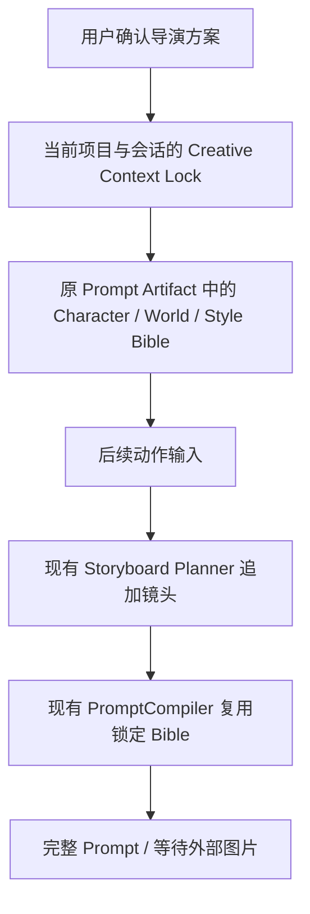

# Comic Context Continuity & Critic Feedback

## 当前修正：直接编辑与显式对话修改（2026-10-09）

本节优先于下方历史记录中的默认续写行为。普通创作消息生成独立 Project/Director 页面，沿用当前会话的设定记忆；只有主动选择“用对话修改 / 修改当前方案”才修改所选方案。

- 归属为 Comic Domain 的公开决策编辑、现有 Shell API 的版本/会话校验，以及 DirectorWorkspace 的编辑状态。未修改 Core Runtime、Provider、Compiler 或数据库结构，未新增依赖和并行服务。
- 失败 Trace `trace-60e8984f07b2` 的模型输出达到 4096 token 上限，随后公开草稿格式校验失败。原修改入口要求重写整份草稿，现改为返回白名单公开字段的 `changes`，由服务端合并、校验并记录字段来源；兼容旧完整草稿响应。硬约束、绑定版本、审核结果与来源字段不能通过该补丁改写。
- 修改上下文包含所选未确认草稿的设定锁、固定资产和当前公开决策。未修改字段及历史版本保留；修改后清除旧审核与确认，仍须检查并确认该新修订，不自动应用审核建议。
- UI 将生成新任务和保存编辑的状态分开。保存前固定所选草稿与字段，避免 busy 状态切换到最近任务而把另一轮的创作理解写入当前方案。
- 对话修改固定 Project、Conversation、Run、导演版本和作品版本。切换方案、开始直接编辑或取消修改时退出该模式；失败保留输入供原目标重试，晚到的响应不覆盖新选择。各方案的未保存字段独立，修改旧方案不会改变下一轮普通创作的记忆来源选择。
- 沿用不可变导演版本表、原 API 与 Run History。已备份实际数据库后启动标准服务，未删除或覆盖用户方案、会话或历史；没有调用付费文本、图片或视频模型。

验证：后端全量 938 项通过（520.86 秒），其中 `tests/test_comic_director_drafts.py` 专项 17 项另行通过；前端 89 项通过，类型检查/正式构建及修改文件 Ruff、结构检查通过。全库 Ruff 仍有修改前已有的两处 E501 和一处 I001，未修改无关测试。浏览器使用隔离 HTTP/SQLite 与离线文本替身，已验证两种修改入口、原意图/人物保留、三个独立创作方案、失败输入保留、切换目标和未保存草稿隔离。截图位于 `data/qa/director-revision-actions/`。付费模型语义质量未做真实调用验收。

人工验收：先发送两轮普通创作，各自打开方案；在第一轮直接编辑并保存，再选择“用对话修改”提交要求。第一轮追加修订，第二轮保持不变。修改成功或取消后，输入第三轮普通创作，应出现新的独立方案；已保存修改仍需要重新审核及确认。

## 当前修正：上下文锁与审核状态（2026-10-06）

本节记录本次导演架构修正，优先于下方此前模块的阶段记录。UI 布局、模板和样式不在本次修改范围内；前端只接收服务端的确认/制作资格，避免隐藏内部审核结果后错误禁用原按钮。

| generation_mode | 进入条件 | review_required | 审核节点职责 |
| --- | --- | --- | --- |
| FIRST_GENERATION | 当前创作上下文首次生成 | false | Internal Validator，内部有界修复，不公开审核建议 |
| USER_EDIT | 同会话自然语言修改、节点编辑或人工草稿修订 | true | Context Diff → Director Review，保存冲突及推荐同步修改 |
| NEW_CONTEXT | 明确新对话、新项目、重新设计、完全不同主题 | false | 创建新 Brief 边界，重新内部验证，不继承旧设定 |

- 复用原 `ComicDirectorCoordinator` 的 State、阶段节点、恢复与 Core Run，不创建新的执行框架。Critic 的实际结果仍供服务端校验；首次/新主题的 API、历史及节点输出隐藏审核建议，不伪造 pass。不可修复的阻断问题保留真实等待状态及错误依据。
- 首次成功保存导演方案即建立 `CreativeContextLock`，无需等待人工确认。六类设定为 character、world、visual_style、camera_style、environment、fixed_attributes。锁沿用现有不可变版本表，绑定 Project/Conversation/Brief/Director；旧锁缺少新字段时按兼容默认值读取，无数据库迁移。
- 同一创作会话默认修改当前上下文，不再通过模型猜测新主题。动作输入保留原角色、对手、环境、画风、构图和摄影，只改变动作；明确更换某项才释放该项。天空/时间/色彩局部修改在原 Compiler 中按字段继承未修改的地点、世界观、摄影风格和材质，保存来源 Artifact 与 hash。
- USER_EDIT 保存真实字段前后差异、影响字段和范围，并将 Diff 交给原 Critic。用户修改不自动应用 Critic Patch；审核输出问题、潜在冲突及同步修改建议。已确认方案的动作续写同样审核，遇到阻断先保存 WAITING Run，不创建新镜头/Prompt。
- 显式重置追加 Brief/锁修订，旧会话、历史方案和 Artifact 保留。相同内容的重置仍创建新边界；同一个 fork 请求的重复提交保持幂等。恢复继承原 generation_mode，重新审核未编辑的首次方案仍属于内部验证。
- 服务端返回 `validation.can_confirm/can_produce`，原审批、硬约束和资产版本校验继续执行。没有新增依赖、图片/视频调用或生产数据修改。

当前回归覆盖帝皇侠/异能兽/黄昏废墟动作续写、首次隐藏审核、天空/夜景/镜头修改、显式重置、否定重置、刷新持久化、会话隔离、局部 Bible 字段继承和冲突阻断。验证使用离线模型替身，付费模型及人工审美验收未执行。

本次验证：后端全量 883 项通过（575.95 秒）；最终收紧节点输出后，上下文、状态、Coordinator、Critic、人工草稿与质量专项 190 项重新通过（196.93 秒）。前端 75 项通过，类型检查/正式构建、Ruff、结构检查均通过。标准后端入口在隔离库中启动，打包页面 HTTP 200；`npm run dev` 启动及页面访问正常。没有向现有生产库写入验收数据。

下方是前一轮上下文/审核解释模块的历史报告，其旧测试数量、文件哈希及确认时建锁的描述不作为本次修正的验收结果。

## 修改目的与边界

修复 Comic 当前创作会话中，已确认角色、世界和风格在动作补充时丢失的问题；把审核枚举转换为用户可以执行的修改说明。

DirectorSpec、SkillLoader 和 PromptCompiler Schema 未修改。继续使用原 Skill、Context Builder、DirectorCoordinator、PromptCompiler、Core Run 与 Artifact。默认仍为完整 Prompt → 等待外部图片，没有接入图片 Provider、费用审批或 Task Center。

## 上下文继承



- 确认时锁绑定项目、会话、Brief 和导演版本。首次完整 Prompt 保存后补齐三个 Bible 的不可变 Prompt 修订及 Artifact 引用。
- 锁引用保存在现有 `comic_entity_versions` 中，不建新表，不复制 Bible 内容，不创建第二套 Context Store。
- 普通动作补充保留 Brief、DirectorSpec、角色及场景资产版本，只追加 Shot。服务器强制保留主体、环境与资产引用，不依赖模型自觉。
- 用户明确编辑并确认 Prompt 中的固定设定后，仅更新当前会话中实际改变的 Bible 来源，下一 Shot 不回退人工修订；模型输出不能触发这一更新。
- 首个完整 Prompt 尚未编译时，先用已确认导演方案建立基础分镜，再处理动作补充。
- 明确“换角色 / 角色改为”“换世界 / 场景改为”“换风格 / 画风改为”才释放对应 Bible。动作、姿态补充及否定换设定的命令保持锁定。
- 更换设定前若 Bible 尚未形成，复用原 Compiler 先保存原设定；随后新 Brief 只记录真实用户请求。保留的 Bible 通过 Artifact 引用注入导演 Context，不冒充用户事实。
- 新导演方案仍需人工确认。普通分镜和 Prompt 编译不会直接生成图片。
- 相同原始 Brief 的明确重做保留原导演入口；锁在确认新修订时继承原 Bible 引用。
- 长会话通过当前导演版本的精确 Run 关联查询定位来源，不依赖普通任务列表的分页结果。
- 若资产或导演决策合并使锁定 Bible 发生变化，编译明确报告设定冲突，不静默改写角色、世界或风格。

## 审核解释

`public_critic_feedback()` 是真实审核记录的公开投影，不改变 DirectorSpec 或原 Critic Result：

```json
{
  "level": "blocking",
  "issue_type": "required_parameter",
  "message": "机位尚未确定唯一执行方案",
  "reason": "当前仍包含低角度或平视两个候选，后续镜头无法确定执行参数。",
  "suggestion": "选择并填写一个最终机位，再重新审核。",
  "affected_field": "cinematography.camera_angle"
}
```

额外提供中文字段名称和影响说明。内部 code 留在原审核及日志中，不用于界面正文。专业审核页及最终确认页显示问题、原因、影响和修改建议。

角色或场景缺失、逻辑冲突、必要执行参数缺失显示为需修改的问题；构图、色彩、氛围和摄影建议显示为可选建议。仅含建议的合法审核可以确认，原审核仍保留 `needs_revision`，不会伪造为 `pass`。

旧审核若没有公开解释，显示“审核说明待更新”，而不是展示内部枚举或冒充审核通过。

## 文件与职责

| 文件 | 本模块修改 |
| --- | --- |
| `domains/comic/projects.py` | 不可变锁引用、原 Bible 读取、明确设定更换命令 |
| `domains/comic/storyboards.py` | 在原规划入口注入锁，约束追加 Shot 的主体、环境和资产 |
| `domains/comic/director.py` | 原导演模型入口接受显式绑定的锁定 Context，保留原来源 |
| `domains/comic/coordinator.py` | 将锁传入原 Context；公开审核反馈及中文失败阶段名称 |
| `domains/comic/critic.py` | 将真实审核问题投影为公开问题、原因、影响和建议 |
| `shells/web_studio.py` | 原 Comic API 的继承、编译和确认绑定；没有增加图片入口 |
| `frontend/src/components/DirectorWorkspace.vue` | 使用当前创作上下文，选择返回的新 Shot |
| `frontend/src/components/DirectorNodeView.vue` | 显示审核解释，不展示 code |
| `frontend/src/services/core.ts` | 补充本模块返回类型 |
| `tests/test_comic_context_continuity.py` | 两轮继承、持久化、隔离、局部解锁、实际审核与确认门禁 |
| `frontend/tests/director-workspace.test.mjs` | 真实组件渲染及实际发送处理函数回归 |

新增文件仅为本报告和模块回归测试；没有删除文件或新增依赖。修改不建立平行系统，原 Core、Provider 与外部图片入口保持兼容。

## 验证与人工验收

自动检查结果及只包含本模块增量的补丁位于 `data/qa/comic-continuity-feedback-20261006/`，该目录不进入提交。

- 后端全量 834 项通过。随后补充人工修订继承兼容：上下文模块与现有 Prompt 回归共 68 项通过。
- 前端 73 项通过，类型检查与隔离构建通过；后端静态检查及结构检查通过。
- 将模块增量应用到当前已提交版本独立验证，27 项模块回归通过，避免依赖工作区其他未提交修改。
- DirectorSpec / PromptCompiler 文件哈希和原已暂存改动均与本模块开始时一致，SkillLoader 未修改。

1. 在 Comic 创作对话输入“东方修仙少女夜晚山巅”，查看并确认导演方案。
2. 完成首个镜头完整 Prompt，记录人物、世界和风格三段。
3. 同一对话输入“手持长剑战斗”。新 Shot 的三段设定应逐字保留，Shot 段出现新动作；完整 Prompt 可复制到外部图片模型。
4. 在审核中保留“低角度或者平视”两个候选，确认界面解释机位为什么不能确定，以及如何选择最终值。
5. 核对仅含构图或色彩建议的方案可以确认；明确更换角色后，新导演方案需再次确认，世界与风格引用保留。

本模块模型行为回归使用离线测试替身，没有新增付费文本、图片或视频请求。人工产品验收应使用前端开发入口；隔离构建产物未覆盖工作区已有的前端发布文件。

提交须仅使用模块增量补丁。工作区已有其他未提交的 Schema 和 UI 修改，以及已暂存的布局文件移动，均不属于本模块。
