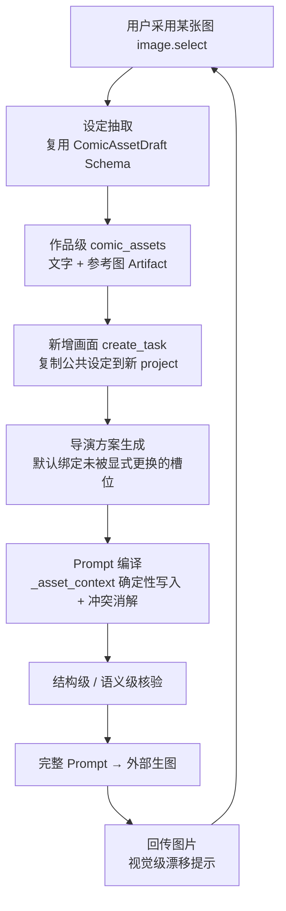

# Comic 设定一致性：缺口分析与改进方案

> 场景：新建作品 → 连续多画面生图（完整 Prompt 复制到外部模型 / codex 执行）。
> 现象：用户从不主动填写人物形象、服装、背景等设定元素；后续画面的 Prompt 若不显式复述这些元素，外部生图就会换脸、换装、换场景。
> 本文只描述现有真实链路、缺口成因与分期方案，不包含任何针对具体素材的硬编码。

## 一、结论

当前系统把"设定"存放成了两种东西：**用户原文里的显式要求**，和**单个画面（单个 project）内的创作锁**。两者都撑不住"连续画面"这个场景：

- 用户不会写显式要求 → 第一条事实源为空；
- 创作锁以 `project_id` 为键，而"新增画面"会创建一个新的 project → 第二条事实源跨画面即断。

于是每个画面的三段 Bible（Character / World / Style）都由模型在本次重新推导。**缺少的不是"更强的模型"，而是"设定事实源 + 默认继承规则 + 一致性核验"这三件基础设施。**

## 二、现有链路的事实走查

| 环节 | 真实实现 | 是否携带设定 |
| --- | --- | --- |
| 新建作品 | `ComicWorkspaceStore.create()` → `ComicProjectInput(title)` | 只有标题，没有 Brief、没有资产 |
| 新增画面（对话） | `comic_work_turn` → `create_task(..., conversation_id=...)`，**同一作品对话**下新建 project | 该分支 `public = []`，**公共设定根本不复制** |
| 新增画面（按钮） | `POST /api/comic/works/{id}/image-tasks` → `create_task()` 不带 conversation | 反而会复制 `assets.list(work_id)`，但会另起一个会话 |
| 导演方案 | 模型的创作选择，`origin=model_choice`，绑定 `asset_versions` | 只绑定"被显式选中的资产"（`retained_assets`） |
| 完整 Prompt 编译 | `StructuredImagePromptCompiler.compile()` | 三段由模型现场推导 + `_asset_context()` 合并资产事实 |
| 跨画面复用 | `ComicPromptStore.reused_context()` | 按 `director_spec_version` 过滤 → 新画面必然不命中 |
| 生成后核验 | `verify_prompt_constraints()` | 只核验"用户要求是否被正文覆盖"，不核验"是否与既有设定冲突" |

### 关键代码位置

- `domains/comic/workspace.py:438` `create_task()`：新画面 = 新 project；`:494` `public = [] if conversation_id else self.assets.list(work_id)`——**对话内新增画面时这条复制被跳过**。
- `shells/web_studio.py:3777`：`comic_work_turn` 带 `conversation_id` 调 `create_task`，正是截图里的主路径。
- `domains/comic/prompts.py:135` `prompt_constraints()`：只把 `semantic_constraints` 和 `asset.fixed_constraints` 变成约束。
- `domains/comic/prompts.py:99` `_asset_context()`：唯一确定性的设定写入口，依赖 `assets` 非空。
- `domains/comic/prompts.py:624`：`_asset_context(contexts, assets)` 在模型输出之后执行。
- `domains/comic/prompts.py:870` `reused_context()`：`director_spec_version != director.version` 直接跳过。
- `domains/comic/prompts.py:1072` `source()`：编译入参的资产来自 `shot.character_asset_versions` / `scene_asset_versions` / `style_version`——**必须由导演方案绑定**，不是"项目里有就生效"。
- `shells/web_studio.py:3767` `selected_assets`：资产由对话记忆的字段选择驱动，未显式引用就不绑定。
- `domains/comic/projects.py:759` `save_context_lock()` / `:819` `locked_bibles()`：`CreativeContextLock` 以 `(project_id, conversation_id)` 为键。
- `frontend/src/components/comic/WorkSettings.vue` + `DirectorWorkspace.vue:1812`：设定面板存在，但藏在对话页折叠的「引用或发布作品公共设定」里。

## 三、成因拆解

### 成因 A：没有"设定事实源"，只有"用户原文"

`create_task()` 建 Brief 时只带两类东西：对话路径带 `source_brief`（用户原文 + 从原文提取的 `hard_constraints` / `semantic_constraints`），按钮路径只带 `{"original_request": requirement}`。两者都只有"用户说过的话"。

这是**正确的**——用户没说就不能编造成用户事实。但它也意味着：用户只说"鸣人在意识空间跟九尾对峙"时，系统对"人物长什么样"没有任何可持续的存储。`normalize_constraints()` 只会提取用户明示的要求，不会、也不应该凭空生成外貌描述。

抽取这件事不是没有入口：`publish_setting` 可以把画面资产提升为作品公共设定。但它是纯手工的，入口在折叠 `<details>` 里，且要求用户先有"画面资产"——而画面资产同样没有任何自动创建路径。

### 成因 B：设定载体的作用域选错了

`CreativeContextLock` 绑定 `(project_id, conversation_id, brief_version, director_version)`。而"新增画面"= 新 project，所以：

```
画面 1 (project-A) ── 锁 A ──> Prompt A 的三段 Bible
画面 2 (project-B) ── 查锁 B ──> 未命中（锁 A 不在 project-B 上）
```

`docs/architecture/comic-context-continuity-feedback.md` 里承诺的"沿用当前会话的设定记忆"，在**跨画面**这条路径上从来没有真正接通。

更隐蔽的是"公共设定复制"在两处入口行为不一致：对话内新增画面（用户实际使用的路径）传了 `conversation_id`，`public` 被置空，**作品级设定一次都没有被带进新画面**；而按钮新增画面反而会复制，却另起会话。也就是说，即便用户手工建好了作品设定，主路径也用不上。

### 成因 C：复用判据是"同导演版本 + 文本相等"，不是"设定实体身份"

`reused_context()` 同时要求：

1. `prompt.director_spec_version == director.version`（新画面必然不等）；
2. 角色复用还要 `prompt.character_asset_versions == shot.character_asset_versions`，且 `bool(assets)` 或 `previous_shot.subject == shot.subject`。

第 2 条把"同一个角色"退化成"同一句主体描述文本"。用户只要换个说法（"鸣人开启仙人模式" vs "鸣人站在水面上"），判等立刻失败——**这是设计上把"身份"误当成了"字符串"**。

### 成因 D：编译期只"允许沿用"，没有"必须继承"

编译器给模型的指令是「`reused_bibles` 是已保存的相同身份设定，必须沿用」。这句话只在 `reused_bibles` 非空时有意义。为空时，模型面对的是"本轮镜头要求 + 导演方案"，它只能**重新发明**一个角色——而且每次发明都合理，只是彼此不同。

真正确定性的通道只有 `_asset_context()`，它依赖"导演方案已绑定资产"。链路刚好卡在：**资产不存在 → 导演不绑定 → `_asset_context` 空转 → 模型自由发挥**。

### 成因 E：生成后没有一致性判据

`verify_prompt_constraints()` 的判据是"用户的每条要求是否被正文覆盖"。它天然无法回答"这一镜的服装是否与上一镜相同"——因为"上一镜的服装"既不是约束，也不在任何被核验的集合里。

视觉侧同理：`image_review` 已经具备视觉模型与 `reference_context` 绑定能力，但没有"把新图与设定参考图比对"的检查项。

## 四、改进方案

设计原则：**复用现有实体与表结构，不新建业务表、不新建平行系统、不引入依赖。** 所有判定基于"槽位 + 资产身份 + 版本"，不基于任何人名、作品名或文件名。

### 4.1 L1 设定事实层：把"用户已采用的画面"变成作品级设定

**触发点**：`image.select`（图片工作台「采用此版本」）成功后。这是唯一同时满足"用户看过图"和"用户接受了这份视觉"的事件，是最可靠的授权锚点。

**抽取输入**：已采用的图片 Artifact + 该图对应 Prompt 的三段（Character / World / Style）+ 作品级已有设定（用于合并，而非覆盖）。

**抽取输出**：`ComicAssetDraft`（`character` / `scene` / `style` 各至多一份），写入 `work_id` 作用域的 `comic_assets`：

- `reference_artifact_ids = [已采用图片的 artifact_id]` —— 让设定同时拥有文字与视觉锚点；
- `fixed_constraints` 只放"跨镜头不变"的项（发型、主色、服装款式），不放姿态、光位、构图；
- 溯源写入 `source_ref`（image artifact → prompt artifact → asset version），供后续审计与回滚。

**为什么这不算"编造用户事实"**：抽取结论只能落在既有的两类来源里——`origin=model_choice`（`trust=creative_choice`，模型在这次采用里补的具体外形）或 `origin=asset_fact`（`trust=source_verified`，以"用户采用了这张图"为核实依据）。**永远不会是 `user_request`**。UI 必须标注"来自已采用的图片"，用户可以改、可以删。

**幂等**：以 `(slot, 规范化文本指纹)` 去重；同槽位内容变化 = 该资产的新版本，历史版本保留。沿用现有 `request_id` 回放语义。

### 4.2 L2 继承解析层：默认随行，显式声明才覆盖

**位置**：新增画面生成导演方案之前（`web_studio.py` 的 `selected_assets` 计算处），不是编译期。

原因是硬约束：`source()` 只认 `shot.character_asset_versions`，而 `director.schema_version == 2` 又要求 `director.asset_versions` 与资产版本一致。**资产必须在导演定稿时绑定**，编译期再补会直接触发"Prompt 资产版本与已审核导演方案不一致"。

**优先级（从高到低）**：

```
本轮用户显式声明   >  本轮显式更换（explicit_context_changes 释放）  >  作品级设定  >  模型自由发挥
```

**判定键**：`(slot, work_id)` → 资产当前版本。彻底不再比较 `subject` 文本。

**释放语义复用已有实现**：`ComicContextBuilder.explicit_context_changes()` 已经能识别"换角色 / 场景改为 / 画风改成"，并排除"姿态、动作、表情"等非设定变更。把它的结果作为"本轮不绑定该槽位"的依据即可——不需要新增词表。

**容量**：沿用现有"公共设定 ≤ 8"与"单轮选中资产 ≤ 8"的限制，超出时按槽位优先级裁剪并显式提示，不静默丢弃。

### 4.3 L3 渲染层：冲突消解，而不是无脑拼接

现状：`_asset_context()` 用 `；` 把资产事实追加到模型正文后面。如果模型写了"黑色长风衣"而设定是"橙黑运动外套"，最终 Prompt 会**同时包含两套描述**，外部模型只能二选一——这是漂移的第二个入口。

需要补两条：

1. **冲突优先**：同一槽位/字段内，资产事实优先；模型正文中与之语义冲突的分句在合并前剔除。判定走模型语义比较（复用 `verify_prompt_constraints` 的调用通道），不做字符串匹配。
2. **预算**：三段已有长度上限（600 / 1000 字），资产事实先占位、模型补充后追加；超限时降级保留资产事实。

### 4.4 L4 校验层：三级，结构级必须阻断

| 级别 | 判据 | 是否阻断 | 复用 |
| --- | --- | --- | --- |
| 结构级 | 每个已绑定槽位在最终四段中**必须**出现；被显式释放的槽位**必须不**出现 | 阻断，服务端补齐 | `project_constraint_requirements()` 已有的"按 scope 写入对应字段"机制 |
| 语义级 | 正文与资产事实是否语义冲突（不是"是否覆盖用户要求"） | 阻断，走一次有界重编 | `verify_prompt_constraints()` 的核验通道 |
| 视觉级 | 回传图片与设定参考图的漂移项（发型/主色/服装结构/场景骨架） | 只提示 | `image_review` 的 `analyze` + `reference_context` |

视觉级**故意不阻断**：视觉判定天然有误差，阻断会误杀可用图。它的价值是把"漂移"变成可见信号，让用户决定是否换图，而不是让系统替他决定。

### 4.5 数据流



## 五、保障机制

| 机制 | 具体要求 |
| --- | --- |
| 不伪造用户事实 | 抽取结果 `origin` 恒为 `creative_choice` / `asset_fact`，永不为 `user_request`；UI 明示来源 |
| 不静默改写 | 设定与用户本轮要求冲突时，报告并让用户选择，不自动覆盖任何一侧 |
| 显式声明可覆盖 | 用户说"换成红衣"即释放该槽位，作品设定不得把它拉回去 |
| 可追溯 | 每条设定携带 image artifact → prompt artifact → asset version 的完整链路 |
| 幂等与并发 | 沿用 `request_id` 回放 + 版本 CAS；重复采用同一张图不产生重复资产 |
| 失败可诊断 | 抽取失败不阻断出图，降级为"未建立设定"，记录 `trace_id` / `error_id` |
| 不新增表 | 全部落在 `comic_assets` / `comic_entity_versions` / 现有 Prompt 修订 |
| 门禁不放宽 | 不伪造 Critic pass、不默认填充导演结果 |

## 六、通用性要求（反硬编码）

方案必须对任意题材成立，明确禁止：

1. **不出现任何人物名、作品名、题材词表**。槽位来自 `context_declaration.CONTEXT_FIELD_GROUPS`，不在业务代码里写 `if "鸣人" ...`。
2. **不比对具体文本**。判定一律用"槽位 + 资产 id + 版本 + 内容指纹"。
3. **抽取走模型 + Pydantic Schema**（`ComicAssetDraft`），不写字段映射规则表；新增题材不需要改代码。
4. **参考图只认 Artifact**，不假设文件名、扩展名或存储路径。
5. **阈值配置化**。视觉漂移的容忍度放在配置里，不写死相似度常数。
6. **样式无关**。设定面板对任何 works 都通用，不为单一作品的 UI 文案做特例。

验收时用两到三个**题材不同、画风不同**的用例（例如：真人写实 / 二维动画 / 三维渲染），确认同一个流程都能跑通——只在一个素材上跑通不算完成。

## 七、分期与验收

### P0（最小闭环，建议先做）

- 采用图片后自动建立/更新作品级设定（3 个槽位各至多一份）；
- **两个新增画面入口统一**：解析"默认随行设定"时不区分是否带 `conversation_id`，把作品级设定按槽位复制到新画面；
- 新画面生成导演方案时默认绑定未被显式更换的槽位；
- 结构级校验：已绑定槽位必须出现在最终 Prompt。

**验收**：连续三个画面，第二个画面的文字需求完全不提人物外形，其完整 Prompt 的三段仍逐字包含第一张图确立的外貌与服装；第三个画面说"换成红衣"后，只有服装段变化，其余保持。

### P1

- 冲突消解（模型正文与资产事实冲突时以资产为准）；
- 语义级核验接入编译重编流程；
- 设定面板从折叠区提升为可见的"作品设定"入口，支持编辑与停用。

**验收**：人为让模型写出与设定冲突的服装，最终 Prompt 只出现一套描述，且核验记录能指出被剔除的分句。

### P2

- 回传图片的视觉漂移提示（不阻断）；
- 设定跨作品复用（`settings_refs` 已有基础）；
- 漂移率、设定命中率进入可观测指标。

**验收**：上传一张明显换装的图，界面能指出"与作品设定的服装主色不符"，但仍允许采用。

## 八、预期业务收益

| 维度 | 现状 | 改造后 | 度量口径 |
| --- | --- | --- | --- |
| 跨画面一致性 | 每镜重新描述，漂移随机发生 | 同一份设定被确定性写入每一镜 | 设定槽位在 Prompt 中的命中率 = 100%（结构级保证） |
| 返工成本 | 每次漂移 = 一次外部生成 + 一次人工上传 | 结构性漂移被提前拦在编译期 | 单作品重生成次数 / 人工改图次数 |
| 冷启动成本 | 用户需先读设定面板并手工填写 | 采用第一张满意的图即自动建档 | 从新建到首个可复用设定的操作步数：N → 1 |
| 可复用资产 | 设定只活在单画面 | 作品级设定沉淀，可跨画面、跨作品引用 | 作品级资产数量 / 复用次数 |
| 质量可观测 | 一致性靠主观感受 | 命中率、漂移检出率成为指标 | 每作品漂移提示条数、采纳率 |
| 用户信任 | 系统"看起来记得"，实际不记 | 设定可见、可改、可追溯 | 设定编辑/停用操作的完成率 |

更重要的一条：**这是把"模型自觉"换成"系统保证"**。一致性不再取决于每次提示词写得多完整，而取决于设定是否被建立、是否被默认继承、是否被核验——这三件事都可测试、可回归、可度量。

## 九、风险与边界

| 风险 | 影响 | 缓解 |
| --- | --- | --- |
| 抽取结论错误并被固化 | 错误比漂移更难发现 | 候选态由"采用图片"授权；面板可改可停用；版本可回滚 |
| 过度继承 | 用户想换角色却被拉回 | 显式更换信号优先；释放机制复用 `explicit_context_changes` |
| 上下文膨胀 | 三段超长被截断 | 资产事实优先占位，模型补充按预算裁剪 |
| 视觉校验误报 | 误拦可用图 | 只提示不阻断 |
| 导演版本耦合 | 资产变更导致"资产版本与方案不一致" | 绑定发生在导演定稿前；变更需重新生成方案，沿用现有门禁，不放宽 |

## 十、涉及文件（预估，最终以实施时为准）

| 文件 | 职责 |
| --- | --- |
| `domains/comic/assets.py` | 设定抽取结果的落库入口（复用 `create` / `change`） |
| `domains/comic/prompts.py` | `_asset_context` 冲突消解；结构级校验接入 |
| `domains/comic/workspace.py` | `create_task` 的默认绑定解析 |
| `shells/web_studio.py` | `image.select` 后触发抽取；`selected_assets` 增加"默认随行" |
| `frontend/src/components/comic/WorkSettings.vue` | 设定可见化、来源标注、停用 |
| `tests/test_comic_*` | 跨画面继承、显式更换释放、冲突消解、幂等 |

不新增数据表、不新增依赖、不新增并行服务；历史版本继续交给 Git 与现有不可变版本表。
