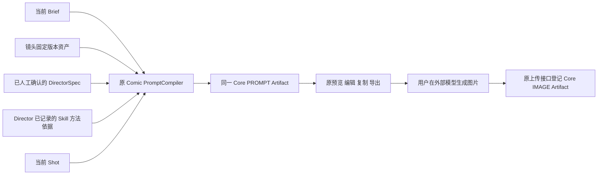

# Module 1：Comic Prompt 链路治理验收

日期：2026-10-06。状态：来源治理方向已认可；补充 Context Schema 分离，等待最终人工验收，尚未提交。

前置治理 Module 0 已获人工通过并提交为 `119f23e`。本轮只修改现有 Comic Domain 的 Prompt Schema、Compiler/Store、相关回归及文档，不迁移 Core、Provider，不修改 UI、导演、Skill 或 Critic。未接入图片生成、视频、费用审批或 Task Center。

## 入口与契约



| 入口 | 负责什么 | 本轮处理 |
| --- | --- | --- |
| `shells/web_studio.py::compile_comic_prompt` → `domains/comic/prompts.py::compiler_for_model` | 当前 Comic 分镜的完整 Prompt，默认外部模式 | 保持入口和确认门禁，增强原 Compiler |
| `ComicPromptStore.save` → `RuntimeStore.insert_artifact` | 同一事务写 Prompt 不可变修订及 Core Artifact | 保持既有表和版本指针，追加来源信息 |
| `image_prompt` | 预览、复制、导出同一正文及负向约束 | 不新增另一份生成内容 |
| `ComicPromptStore.payload/confirmed/import_image` | 原确认记录、Shot 快照、外部上传关联 | 受约束只读投影，保持版本/指纹和上传契约 |
| `tools/prompt_factory.py::build_prompt/create_recipe` | 历史 Persona/Recipe 入口 | 兼容保留，不接入当前 Comic 主链 |
| `tools/studio.py::compose_prompt/refine_prompt`、`domains/comic/skills.py` | 历史 Studio/compose Skill | 兼容保留，不扩展为新的 Compiler |
| `capabilities/creative.py::compile_image_prompt`、Shell `_enhance_prompt` | 首页/旧创作入口 | 本轮冻结，不统一改写首页 |

EX-11 在当前 Comic 主链上的契约已明确；其他入口属于历史兼容，不能宣布全项目 Prompt 实现已消除。新增 Comic 功能只能复用上述 Compiler → Artifact 路径，不能复制 PromptBuilder/Helper/Manager/Generator。

## 内容与来源

仍使用一个 `StructuredImagePromptCompiler`；前一轮 `comic-prompt-2`、本次 `comic-prompt-3` 都是同一实现的修订标记。旧 `complete_prompt=false` 的返回契约保持，旧 Artifact 不被重写。下方旧检查/实测保留为历史证据，最新 Schema 补充见文末。

- v1 扁平 Director 的构图、光线、色彩等有效输入不再因缺少 v2 对象而丢失；v2 使用其三段公开决策，不重复加入兼容别名或 Critic JSON。
- 当前 Shot 的景别、机位、运动和导演主光/色彩先解析为本镜头执行要求，再交给模型。保存的正文使用“景别：”“主光方向：”等自然语言，不再追加程序形式的 `shot_size=...`。
- 固定角色、场景、风格资产以中文标签保留细节及固定约束；不添加供应商参数，不替换未指定的原始 Shot Prompt。
- 五段正文覆盖人物、世界、风格、当前镜头与具体禁止内容。编译指令要求画面位置、空间关系、受光面/阴影、主体/环境色彩关系，而非泛化质量标签。

既有 `context_sources` 增加 `input_lineage`，既有每段 `field_provenance` 增加 `input_basis`：

| 依据 | 保存内容 | 可信含义 |
| --- | --- | --- |
| Brief | ID、版本、完整 Brief hash | 可定位用户需求；不能把 Compiler 补全的外貌当作用户事实 |
| Asset | 当前 Shot 引用的 ID、版本、类型；名称、细节、固定约束、参考 Artifact 的组合 hash | 定位实际固定版本，不混入其他角色；登记资产不等于证明现实真实性 |
| Director Decision | Spec ID、版本、参与编译的公开决策 hash；原字段来源分组 | 创作选择的来源仍以 Director provenance 为准 |
| Skill Method | 仅提取 Director evidence 中已有的 Skill ID/hash/可用版本 | 是知识方法输入证据，不是逐句因果证明；没有记录则明确 `not_recorded`，不补造版本 |
| Shot | ID、版本、分镜 ID/版本、Shot 快照 hash | 定位当前镜头及执行要求；景别/机位归属 Shot，主光/色彩归属 Director 字段 |
| 复用 Bible | 原 Prompt Artifact ID、当前内容 hash | 追溯原 Artifact 的来源，不冒称新请求生成 |
| 模型生成/人工编辑 | 模型请求关联或编辑 Run、内容 hash、父 Artifact | 模型段落仍为 `model_choice/creative_choice`；编辑段为 `manual_edit/creative_choice`，不伪造事实确认 |

各段 `input_basis` 是参与生成的依据集合，不保证每个依据均影响输出。旧无来源记录的 Artifact 不回填虚构来源。未修改段保持原 provenance；编辑段保留原输入依据、关联父版本，同时清除“由当前模型请求生成”的标记。后续镜头复用已编辑 Bible 时保留原编辑来源，而非改标为新模型选择；来源元数据不重复加入模型的 Bible 正文输入。

## EX-12 查询治理与兼容边界

确认仍读取原 `comic.prompt.confirm` 已完成 Run，核对同一 Project、Shot、Artifact、版本和完整内容指纹；不新增确认表、缓存或业务 Workflow。

移除确认查询的“最近十万条”上限，只在数据库筛选匹配归属的记录；图片投影/去重筛选同一 Project、Shot、Prompt 的 ready 外部上传 Artifact；Shot 快照直接定位所需修订。完整历史浏览接口仍保留。

由于 Core 的公开查询接口尚不支持这些业务关联，本轮在已有 Domain Store 内通过现有连接读取原表，只发 `SELECT`，没有 Core 源码、表、索引或迁移改动。这是明确的历史数据库契约耦合。JSON 过滤仍可能扫描数据库；本轮证明减少全量对象加载、修复旧确认漏检，不声称实现索引级常数时间查询。未来公开查询接口调整时必须保持这些回归，不能复制存储系统。

## 自动检查

- 完整后端：786 项通过，392.25 秒。随后补充外部图片归属投影、编辑依据保留与复用人工编辑 Bible 来源；Prompt 专项 24 项通过，15.06 秒，最后复用来源兼容处理另行复验，结果见下方文件。
- 前端：69 项通过；类型检查及构建通过。构建输出位于忽略的 QA 目录，没有覆盖已存在的静态 bundle 或 UI 工作。
- 全库 Ruff、原结构守卫、改动文件差异检查通过。
- 回归包括旧导演字段、五段完整性、固定资产、Skill 方法输入、不伪造事实、跨角色隔离、编辑/恢复版本门禁、外部上传去重和归属过滤。
- 隔离库加入 100001 条无关 Run 后，原已确认 Prompt 仍可查得；禁止测试路径调用全量 Run/Image/Shot 历史加载。
- 外部模式回归阻断 Provider、图片预算和生产工作流，HTTP 测试服务正常启动并通过真实本地上传/读取接口。
- 修改前保存的 188 份源码/Skill/UI 文件 hash 对照，仅 `domains/comic/prompts.py` 改变；原有未提交 UI/Shell 工作及已暂存组件移动均保留。新增生产文件和依赖为零。

结果文件：

- [完整后端结果](../../data/qa/prompt-governance-module1-20261006/backend-results.xml)
- [最终 Prompt 专项结果](../../data/qa/prompt-governance-module1-20261006/prompt-results.xml)

## 单次真实文本验收

用户授权一次 `deepseek-flash` 请求，总上限 ¥0.20。在隔离副本复用此前真实生成并人工确认的 Director 和已有分镜，不重新调用导演/图片/视频。最终没有任何额外付费请求。

| 记录 | 值 |
| --- | --- |
| Brief | 东方修仙少女夜晚站山巅 |
| Model | deepseek-flash |
| trace_id | trace-c89a34a5827a |
| run_id | run-985febd133c842a5be96463f97b87ea5 |
| Model response ID | f673f43f-0e0d-406e-806f-58b956883f4c |
| Prompt Artifact | artifact-eedf36e3c4944fa79331d216486eb2d5，Prompt v2 |
| 已记录的 Skill 方法 | comic.creative_understanding、comic.visual_direction、comic.cinematography，完整 hash 在 Trace |
| 用量 | 输入 5592、输出 1220 tokens，retry_count=0 |
| 按配置价格估算 | ¥0.020944，不是供应商最终发票 |
| 媒体状态 | awaiting_external_image |

此场景没有绑定资产；人物服装、外貌等为创作选择。绑定资产的保持与隔离由离线回归验证，不能把本次实测说成真实资产覆盖测试。

真实结果具备完整五段，并沿用导演选择的东方仙侠写实插画/数码厚涂风格，远景、略低平视、右上方画外月光和冷色夜空/暖灰人物关系一致。没有强行把导演插画决策改成摄影风格。

结构验收通过不代表自然语言质量完美：原始人物段仍混入当镜头姿态、目光方向和“无绑定角色资产”等内部表述。保留原结果，以原编辑接口准备 QA 审阅 v3：人物段收敛为持续身份信息。该编辑明确标记 `manual_edit`、保留原输入依据和父 Artifact，并且 `user_confirmed=false`；不是声称模型自动修正，也不是替用户完成人工验收。

- [原始真实 Prompt](../../data/qa/prompt-governance-module1-20261006/live-83c911ee15/final-image-prompt.txt)
- [QA 编辑后的可复制 Prompt](../../data/qa/prompt-governance-module1-20261006/live-83c911ee15/reviewed-image-prompt.txt)
- [真实请求、system prompt、输出和来源 Trace](../../data/qa/prompt-governance-module1-20261006/live-83c911ee15/trace.json)
- [QA 编辑原因与版本关联](../../data/qa/prompt-governance-module1-20261006/live-83c911ee15/quality-review.json)

这些 QA 文件留在本机忽略目录，不进入源码提交。未调用 ChatGPT Image，未生成或评价外部图片，不能声称真实图片效果已达标。

## 前一轮人工验收与下一步

请对照原始与 QA 编辑 Prompt，核对角色一致性、空间/光源/色彩、五段内容和来源；在原编辑/复制流程核对整份正文及负向内容。如需验证外部效果，用户可将审阅版粘贴到 ChatGPT Image。按既定门禁，本模块通过人工验收后才提交；当前不进入 Trace、状态或 Core 治理。

## 人工反馈补充：Context Schema 分离

问题属于 Comic Domain 的 Prompt 契约及编译：原四段是自由文本，人物设定只能靠模型自觉避免动作和摄影；旧混杂段落还可能被后续镜头复用。

直接扩展已有 `models.py` 的 Prompt Schema 和已有 Compiler/Store，不新建 Registry、Builder、数据库、Artifact、Runtime 或依赖。当前模块审阅涉及五个文件：`models.py`、`prompts.py`、`test_comic_prompt_production.py`、工程手册、本报告；其中只有本报告是新的文档。

| Context | 唯一允许字段 | 归属 |
| --- | --- | --- |
| Character | identity、appearance、age、clothing、fixed_features | 身份、固定外貌、年龄、服装、固定特征 |
| World | location、time、world_setting、environment | 地点、时间、世界观、环境 |
| Style | art_style、photographic_style、color、materials | 艺术风格、摄影风格、色彩、材质 |
| Shot | action、pose、composition、camera、lighting_changes | 动作、姿态、构图、镜头、光影变化 |

四段模型输出必须是对象且不允许额外字段，之后按固定中文字段标题渲染。未知年龄保持空值，不替用户补造事实。结构保存到原 `context_sources.structured_contexts`；原 API 的四段文本与正负 Prompt 保留，因此现有编辑、复制、导出不用新增接口或 UI。

Compiler 将导演执行决策与分镜移到请求的 `shot_direction`，避免误称稳定角色设定。已有资产字段明确归属；Scene/Style 的 lighting 进入 Shot，不进入 World/Style；固定资产原文继续核验，混杂的固定资产不能静默改写。

真实模型证明仅有 Schema/指令仍不足。现有 Compiler 对模型输出作有限的确定性分句归位：只把已识别的动作、姿态、取景、空间布局和受光分句移到 Shot，内容不改写，同一分句已存在则不重复追加。`scope_relocations` 保存原字段、目标字段与分句 hash；原模型输出留在真实 Trace。归位后再严格校验；错误类型、额外字段、跨行夹带、缺失身份、超长或无法归位的结构仍明确失败，不伪造合格 Prompt。

分句识别是有边界的规则，不是理解全部自然语言的证明。它覆盖本轮实际暴露及回归中的摄影/姿态混入；含糊、隐含动作或复杂否定仍需人工审阅。没有新增模型修复调用或自动重试，也没有把固定摄影关键词映射成新的导演选择。

同一项目、Brief/Director 版本及绑定角色/场景/风格复用最新合格静态三段。无绑定角色时还核对同一 subject，避免借用另一个角色。按当前修订时间选择，老镜头的最新人工编辑不会被新镜头的旧修订盖过。三段来自同一原 Artifact 时负向约束一并保持。旧自由文本仍可读取，但不再用于自动固定设定。

人工编辑必须保持合法字段标题并重新校验；不能伪造来源、删除契约标记或恢复未分段旧版本来绕过校验。固定资产原文必须保留在对应字段，不能把服装移到 Shot 来通过全正文校验。Style 资产 camera_language 中具体取景也进入 Shot，摄影质感仍留 Style。合法旧记录不被重写，失败编辑不保存新 Artifact 或修改项目版本。人工修改来源及复用链继续保留。

### 补充自动检查

- Prompt 最终专项：44 项通过，19.90 秒。包括绑定/未绑定同角色 A/B 三段及负向逐字相同、动作只进入 Shot、模型错放分句归位及 hash、手动编辑禁止混入姿态、旧污染 Bible 不复用、恢复不得降级、场景/风格光线归属、固定服装不得挪到 Shot、Style 具体摄影归 Shot 和最新人工修订优先。
- 前端：69 项通过；类型检查和构建通过，输出位于本机 QA 目录，未覆盖现有静态资源。
- 分句归位/画幅边界版本完整后端：806 项通过，385.25 秒。该检查启动后补充的两项固定资产字段归属及对应检查，已由上述最终 44 项专项复验；此前首轮全量 804 项亦通过。未声称最新两项已在这份全量 XML 中收录。
- Ruff 全库及原结构守卫通过。HTTP 启动/上传/读取由原本地测试服务回归验证；生产库未启动或覆盖。
- 本次补充前后核对 184 份源码/Skill/UI hash，只有原 Comic `models.py` 和 `prompts.py` 改变；已有 UI/Shell 工作及已暂存文件移动保持。新增生产文件/依赖为零。

结果：[Prompt 专项](../../data/qa/prompt-schema-module1-20261006/prompt-final-results.xml)，[最终完整后端](../../data/qa/prompt-schema-module1-20261006/backend-final-results.xml)。

### 真实模型及回放证据

复用已有真实、已确认 Director，输入“东方修仙少女夜晚站山巅”，A 为“站立远望”，B 为“战斗姿态，原地戒备，不使用武器”。所有操作只写隔离副本，没有再次调用导演、图片或视频。

| 请求 | 结果 | 费用记录 |
| --- | --- | --- |
| 初始 A | 400：JSON 模式要求请求含 JSON 字样；已补指令及断言，未重试 | 未返回用量，未知；QA 预留上界 ¥0.085118，不记为零、不修改账单 |
| 新授权 A（第一次） | 真实内容仍混入摄影/姿态，严格校验拒绝保存 | 按配置用量估算 ¥0.023256 |
| 经明确扩次数授权的新 A | 收紧输入后仍有混入；此输出用于确定性归位回放 | 按配置用量估算 ¥0.022924 |
| 剩余一次 B | 真实新请求成功保存；复用已归位的真实 A 设定 | 按配置用量估算 ¥0.021934 |

后三次合计 ¥0.068114，低于该轮 ¥0.20 上限；每次请求均 `single_attempt`，不自动重试。首个 400 的未知费用独立保留，不能把估算当供应商账单。初次 A 的未知上界与后三次已知估算相加为 ¥0.153232，仅用于本机 QA 保守核对；没有结算或释放任何未知生产账单。

最终补丁还收紧了画幅与侧面取景归属，使用已捕获的真实 A/B 输出离线重编译，零新增请求。最新样例因此是“真实输出的离线重编译”，不是两次最终修订后的新在线请求，也不是人工编造/手动改写人物段。Artifact 明确记录 `replayed_model_output` 原响应 ID、原 Trace、输出 hash 和 `new_provider_request=false`。原始真实输出及失败记录全部保留。

| 内容对照 | 结果 |
| --- | --- |
| Character | 逐字相同，身份/固定外貌/服装/固定特征，无姿态/取景/光源方向 |
| World、Style、Negative | 逐字相同 |
| Shot | A 站立远望，B 战斗姿态/原地戒备，只有此段内容变化 |
| Director | 保持原修订 |
| 主流程 | awaiting_external_image，无图片调用、费用审批或生产工作流 |

当前人物段（未知年龄未打印）：

```text
身份：东方修仙世界的少女修行者
外貌：身形纤细挺秀，高束马尾长发，面容清秀、眉眼平和
服装：青白色素袍长衣配深灰腰封与无纹样束带，浅冷色系直身袍形
固定特征：无可见纹样与门派符号，无配饰点缀，无剑与法器
```

本场景没有绑定资产，补全仍是 `model_choice/creative_choice`；绑定资产一致性由专项回归覆盖。此处证明分段与来源一致性，没有实际调用 ChatGPT Image，不能证明外部图片质量。

- [最终 A 完整 Prompt：站立远望](../../data/qa/prompt-schema-module1-20261006/replay-4eb6e43d81/shot-A-image-prompt.txt)
- [最终 B 完整 Prompt：战斗姿态](../../data/qa/prompt-schema-module1-20261006/replay-4eb6e43d81/shot-B-image-prompt.txt)
- [最终 Schema 对照及原真实输出关联](../../data/qa/prompt-schema-module1-20261006/replay-4eb6e43d81/comparison.json)
- [在线 B 与已录制 A 重编译的 Trace](../../data/qa/prompt-schema-module1-20261006/live-58f0ca8cc4/trace.json)
- [真实 A 原输出](../../data/qa/prompt-schema-module1-20261006/live-b8c4e996f9/trace.json)
- [最初 400 与未知用量记录](../../data/qa/prompt-schema-module1-20261006/live-655b03e5af/trace.json)

### 人工验收与下一步

请审阅最新 A/B，核对角色固定设定完全相同、当前动作/姿态/构图/摄影/光影只在 Shot，再核对现有编辑与复制内容。源治理方向此前已认可，本次 Schema 补充通过人工验收后才提交本模块；当前不进入 Trace、状态或 Core 治理。
